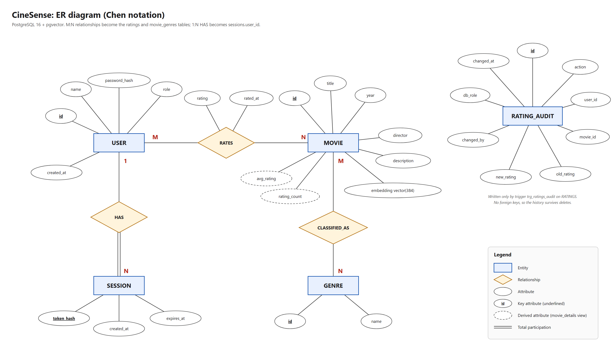

# CineSense: Demo Explanation

This file explains each part of the demo. The commands are in **DEMO_COMMANDS.txt**; the matching section number there is given as *(Commands §n)*.

**Project in one line:** a movie recommender where **PostgreSQL** stores the facts (users, movies, genres, ratings) and **pgvector** (a vector-database extension inside the same PostgreSQL) stores a 384-number "meaning" vector for each movie. A **Next.js** web app sits on top.

**Demo logins:** `admin` / `admin123` (admin), `Aarav` / `viewer123` (viewer; every viewer uses `viewer123`)

**Files for the demo**

| File | What it's for |
|---|---|
| `DEMO_COMMANDS.txt` | every command, section by section. Open it in Notepad and paste sections into psql |
| `DML_COMMANDS.txt` | only the INSERT / UPDATE / DELETE commands (she asked for these in a separate file), plus the queries that prove a UI action reached the database |
| `DEMO_HANDOUT.pdf` | print this: problem statement, ER diagram, relational schema, entity and attribute analysis, and the UI ↔ table map |
| `docs/er-diagram-chen.png`, `docs/er-diagram.png` | the ER diagram (Chen) and the relational schema diagram (crow's foot) |

**Before the demo (5 minutes)**
1. Double-click `start-cinesense.bat`. It starts Docker, the `cinesense-db` database and the app, then open http://localhost:3000.
2. In a second window, open psql: `docker exec -it cinesense-db psql -U postgres -d moviedb`.
3. Once, before she arrives, run `npm run seed` (in the `cinesense` folder) to reset the sample data. **Never during the demo.** It empties the audit log and anything you added.
4. Do one **Meaning** search (for example `robot`) so the embedding model is already loaded, which takes a few seconds the first time.
5. Log out, and have `DEMO_COMMANDS.txt` open in Notepad.

**Demo order (matches the checklist):**

| # | Checklist item | Where in this file | Commands |
|---|---|---|---|
| 1 | Show the users | §1 | §1 |
| 2 | ER diagram | §2 | – |
| 3 | Relational schema / tables | §3 | §2 |
| 4 | Constraints of the operations | §4 | §3, and errors in §4–6 |
| 5 | CRUD: insert, update, delete | §5 | §4, §5, §6 |
| 6 | How the database maps to the UI | §6 | – |
| 7 | How Next.js works | §7 | – |
| 8 | Advanced: triggers | §8 | §7 |
| 9 | Advanced: functions, procedures, complex queries | §9 | §8, §9 |
| 10 | Vector CRUD | §10 | §10 |
| 11 | Security / roles | §11 | §11 |
| 12 | Modification questionnaire | §12 | §12 |
| 13 | Justification of the usage | §13 | – |

---

## 1. The users *(Commands §1)*

There are two kinds of "user":

1. **Application users**: rows in the `users` table. There are 14: one `admin` and 13 viewers (Aarav, Meera, Kabir, …, "New Viewer"). Anyone who signs up becomes a viewer.
   - Passwords are **never stored as text**. `register_user()` stores a **bcrypt hash** made by the pgcrypto extension *inside the database*.
   - Logging in calls the `login()` function, which checks the hash and creates a row in `sessions`. The browser gets a random token in an httpOnly cookie, and the database stores only the SHA-256 of that token.
2. **Database roles**: PostgreSQL's own users:
   - `cinesense_anon`: not logged in (read the catalog, sign up, log in)
   - `cinesense_viewer`: logged-in user (anon + rate movies, own rows only)
   - `cinesense_admin`: admin (viewer + manage movies, users, read the audit log)
   - `cinesense_app`: the login the web server uses. It has **no privileges of its own** and switches to one of the three roles for every request.

**In the UI:** Admin → **Users & roles** lists every account with its rating count and active sessions. You can promote or demote users there.

---

## 2. ER diagram

Files: `docs/er-diagram-chen.png` (Chen notation) and `docs/er-diagram.png` (crow's foot).



**Entities (5):** USERS, MOVIES, GENRES, SESSIONS, RATING_AUDIT

**Relationships**

| Relationship | Type | Becomes the table | Notes |
|---|---|---|---|
| USERS **RATES** MOVIES | M:N | `ratings` | has attributes `rating`, `rated_at` |
| MOVIES **CLASSIFIED_AS** GENRES | M:N | `movie_genres` | a movie can have several genres |
| USERS **HAS** SESSIONS | 1:N | FK `sessions.user_id` | total participation: every session must belong to a user |

- **Derived attributes**: `avg_rating` and `rating_count` are not stored. The view `movie_details` computes them, so they can never be out of date.
- **RATING_AUDIT** has *no foreign keys on purpose*. It is a history log, so it must keep rows even after a user or movie is deleted. Only a trigger writes to it.

**Rule used to map ER to tables:** an M:N relationship becomes its own table whose primary key combines the two foreign keys. A 1:N relationship becomes a foreign key on the "many" side.

### Entity and attribute analysis (the questions she will ask)

**Strong entities: 5.** USER, MOVIE, GENRE, SESSION, RATING_AUDIT. Each one has its own key (`id`, or `token_hash` for SESSION), so each can be identified on its own.

**Weak entities: 0.** A weak entity has **no key of its own**: it can only be identified through its owner entity plus a *partial key*, like a "dependent" identified by (employee_id, dependent_name). None of ours is like that:
- **SESSION** depends on USER for its *existence*: total participation, and it is deleted with the user (`ON DELETE CASCADE`). But it is *identified* by its own `token_hash`, so it is a strong entity with total participation, not a weak one.
- **RATINGS** and **MOVIE_GENRES** aren't entities at all. They are the tables made from the **M:N relationships** RATES and CLASSIFIED_AS (associative entities), identified by the two foreign keys together.

**Relationships: 3.** RATES (USER M:N MOVIE, with attributes `rating`, `rated_at`), CLASSIFIED_AS (MOVIE M:N GENRE) and HAS (USER 1:N SESSION, SESSION has total participation).

| Attribute type | Meaning | In CineSense |
|---|---|---|
| **Key** | uniquely identifies the entity | `users.id`, `movies.id`, `genres.id`, `sessions.token_hash`, `rating_audit.id`. Candidate keys: `users.name`, `genres.name`, and the **composite key** `(title, year)` of movies |
| **Simple (atomic)** | can't be split further | all stored attributes, which is why every table is in 1NF |
| **Composite** | made of sub-parts (e.g. address → street, city) | **none**. A person's name could be split into first and last, but we store it as one value |
| **Single-valued** | one value per entity | all stored attributes |
| **Multivalued** | several values per entity | **none in the final design.** A movie's *genres* were multivalued in the requirement (Interstellar is Sci-Fi, Adventure **and** Drama). The rule for a multivalued attribute is "move it into its own table", which gave GENRE + `movie_genres` |
| **Derived** | computed from other data, not stored | `avg_rating` and `rating_count` of a movie (view `movie_details`), a user's rating count, the similarity score `1 − distance`, the Bayesian score. **Stored but derived:** `embedding` is computed from title, genres and description, and is stored only because computing it is slow (a deliberate denormalization) |
| **Optional (NULL allowed)** | may be empty | `movies.director`, `movies.embedding`, `rating_audit.old_rating` / `new_rating` / `changed_by` |
| **Relationship attribute** | belongs to a relationship, not an entity | `rating` and `rated_at` belong to RATES, which is why they live in `ratings` |

**Participation and cardinality:** a user may have no ratings (New Viewer), and a movie may have no ratings, so RATES is partial on both sides. Every session must belong to a user, so SESSION is total in HAS.

---

## 3. Relational schema: what tables exist *(Commands §2)*

```
users        (id PK, name UNIQUE, password_hash, role CHECK('admin','viewer'), created_at)
genres       (id PK, name UNIQUE)
movies       (id PK, title, year CHECK 1888–2100, director, description NOT NULL,
              embedding vector(384), UNIQUE(title, year))
movie_genres (movie_id FK→movies, genre_id FK→genres, PK(movie_id, genre_id))
ratings      (user_id FK→users, movie_id FK→movies, rating CHECK 1–5, rated_at,
              PK(user_id, movie_id))
sessions     (token_hash PK, user_id FK→users, created_at, expires_at,
              CHECK(expires_at > created_at))
rating_audit (id PK, action CHECK('INSERT','UPDATE','DELETE'), user_id, movie_id,
              old_rating, new_rating, changed_by, db_role, changed_at)

VIEW movie_details = movies + genres (as an array) + avg_rating + rating_count
```

| Table | What it holds | Rows (sample data) |
|---|---|---|
| `users` | accounts and role | 14 |
| `movies` | catalog **plus the vector column** | 105 |
| `genres` | genre lookup | 12 |
| `movie_genres` | which movie has which genre | 269 |
| `ratings` | who rated what, 1–5 | 216 |
| `sessions` | logged-in sessions | grows as people log in |
| `rating_audit` | history written by the trigger | grows with every rating change |

- **Normalization:** BCNF. A flat "ratings spreadsheet" is split as 1NF (genres list → `movie_genres`), 2NF (movie facts depend only on the movie → `movies`) and 3NF (genre names → `genres`). Every determinant is a candidate key. Details are in `docs/REPORT.md` §4.
- **"Show table create":** PostgreSQL has no `SHOW CREATE TABLE`. Use `\d movies` in psql, or `pg_dump --schema-only -t movies` (the commands are at the top of DEMO_COMMANDS.txt). The source DDL is in `db/schema.sql` (tables and view) and `db/indexes.sql`.
- **Indexes:** B-tree on `movies(year)`, `movie_genres(genre_id)`, `ratings(movie_id)`, `sessions(user_id)` and `rating_audit(changed_at)`, plus an **HNSW** index on `movies.embedding` for vector search.

---

## 4. Constraints of the operations *(Commands §3, plus the "EXPECTED ERROR" lines)*

| Constraint | Table | What it stops | Demo error |
|---|---|---|---|
| `PRIMARY KEY(user_id, movie_id)` | ratings | rating the same movie twice | duplicate key |
| `CHECK (rating BETWEEN 1 AND 5)` | ratings | a 9-star rating | check constraint |
| `CHECK (year BETWEEN 1888 AND 2100)` | movies | year 1500 | check constraint |
| `UNIQUE(title, year)` | movies | duplicate movie | duplicate key |
| `NOT NULL description` | movies | missing description | not-null |
| `UNIQUE(name)` | users, genres | duplicate name | duplicate key |
| `CHECK (role IN ('admin','viewer'))` | users | role 'superuser' | check constraint |
| `FOREIGN KEY … ON DELETE CASCADE` | ratings, movie_genres, sessions | rating a movie that doesn't exist; orphans after a delete | foreign key |
| `vector(384)` | movies.embedding | a vector of the wrong size | "expected 384 dimensions" |
| Function rule | `register_user()` | password shorter than 6 characters | custom error |
| Procedure rule | `set_user_role()` | demoting the **last** admin | "Cannot remove the last admin." |
| Procedure rule | `set_movie_genres()` | a movie with no genre | "A movie needs at least one genre." |

**ON DELETE CASCADE:** deleting a movie automatically deletes its ratings and genre links. Deleting a user deletes their ratings and sessions. The commands file shows that no orphan rows remain afterwards.

The app turns these database errors into friendly messages (`lib/http.ts`). For example, error code 23505 (unique violation) becomes "That already exists."

---

## 5. CRUD: insert, update, delete *(Commands §4, §5, §6)*

| Table | Create | Read | Update | Delete |
|---|---|---|---|---|
| users | Sign up → `register_user()` | Admin → Users | Admin → Promote/Demote → `set_user_role()` | Admin → Delete user |
| movies | Admin → Add movie → `add_movie()` | Browse, Movie page | Admin → Edit → `update_movie()` | Admin → Delete |
| genres | created automatically when a movie uses a new genre | genre pills on Browse | – | – |
| movie_genres | Add/Edit movie | genre chips | Edit movie | Edit/Delete movie |
| ratings | click the stars | My Ratings, averages on cards | click different stars | My Ratings → Remove |
| sessions | Log in | Admin → Users (count) | – | Log out |
| rating_audit | **only the trigger** | Admin → Activity log | never | never |

**The upsert.** Rating a movie runs one statement:

```sql
INSERT INTO ratings (user_id, movie_id, rating) VALUES ($1, $2, $3)
ON CONFLICT (user_id, movie_id) DO UPDATE SET rating = EXCLUDED.rating;
```

The composite primary key means a second rating of the same movie becomes an UPDATE instead of an error.

**Suggested UI demo order:**
1. Log in as Aarav and rate a movie 4★ (INSERT).
2. Change it to 2★ (UPDATE).
3. Go to My Ratings and click Remove (DELETE).
4. Log in as admin and add a movie (INSERT + vector).
5. Edit the movie (UPDATE + re-embed).
6. Delete it (DELETE).
7. Promote a viewer, then try to demote `admin`, which is refused.

All the SQL lives in **`lib/queries.ts`**. Every page has a **"Show the query behind this"** panel showing the exact SQL that ran.

**Proving a UI action reached the database:** `DML_COMMANDS.txt` §5 has one query per UI action (sign up, rate, re-rate, remove, add, edit or delete a movie, change a role). Do the action in the browser, then run its query in psql and the new or changed row is there.

---

## 6. How the database is mapped to the UI

| UI page / action | API route | SQL (`lib/queries.ts`) | Tables |
|---|---|---|---|
| Browse: list and keyword search | `GET /api/movies?q=&genre=` | `keywordSearch` | movie_details, ratings |
| Browse: genre pills | `GET /api/genres` | `listGenres` | genres |
| Browse: **Meaning** search | `GET /api/movies?mode=semantic` | `semanticSearch` (vector) | movies.embedding |
| Movie page | `GET /api/movies/[id]` | `movieById` | movie_details, ratings |
| Movie: More like this | `GET /api/movies/[id]/similar` | `similar` (vector kNN) | movies.embedding, movie_genres |
| Movie: Similarity trail | `GET /api/movies/[id]/trail` | `similarity_trail()` (recursive) | movies |
| Stars (any page) | `POST` / `DELETE /api/ratings` | `upsertRating` / `deleteRating` | ratings → trigger → rating_audit |
| Sign up / Log in / Log out | `/api/auth/register`, `/login`, `/logout` | `register_user()`, `login()`, `logout()` | users, sessions |
| For You | `GET /api/recommendations` | `userRatedVectors`, then `recommend` or `popular` | ratings, movies.embedding, movie_genres |
| My Ratings | `GET /api/me/ratings` | `userRatings` | ratings, movie_details |
| Admin → Movies & vectors | `GET /api/admin/movies` | `adminMovies` (`vector_dims`, `vector_norm`) | movies |
| Admin → Add / Edit / Delete | `POST /api/movies`, `PATCH` / `DELETE /api/movies/[id]` | `add_movie`, `update_movie`, `deleteMovie` | movies, genres, movie_genres |
| Admin → Users & roles | `GET /api/users`, `PATCH` / `DELETE /api/users/[id]` | `listUsers`, `set_user_role`, `deleteUser` | users, ratings, sessions |
| Admin → Activity log | `GET /api/audit` | `auditLog` | rating_audit |
| Query Lab (`/lab`) | `/api/lab` | `lib/lab.ts` | all (read-only, with EXPLAIN ANALYZE) |

**How to show a query on the UI ("how to get things on the UI for certain queries"):**
- **Keyword search:** type `space` on Browse. In psql, `SELECT title FROM movie_details WHERE title ILIKE '%space%' OR description ILIKE '%space%';` returns the same list.
- **Genre filter:** click *Sci-Fi*. This matches `WHERE 'Sci-Fi' = ANY(genres)` on `movie_details`.
- **Vector search:** switch to *Meaning · Vector* and type `lonely robot falls in love`. WALL-E and Her come up even though the words don't match.
- **Live change:** run `UPDATE movies SET director='DEMO' WHERE title='3 Idiots';` in psql, then refresh Browse and the card shows DEMO. Set it back to `Rajkumar Hirani`.
- **Query Lab** (admin) has predefined queries: join, nested, correlated, recursive, vector, hybrid, trigger log and RBAC. It shows their results and EXPLAIN ANALYZE plans.

---

## 7. How Next.js works here

Next.js (App Router) is **frontend and backend in one project**, and the folders decide the URLs:

```
app/page.tsx                 →  /                 Browse
app/movie/[id]/page.tsx      →  /movie/5          ([id] is a dynamic segment)
app/login/page.tsx           →  /login
app/recommendations/page.tsx →  /recommendations  For You
app/my-ratings/page.tsx      →  /my-ratings
app/admin/page.tsx           →  /admin
app/lab/page.tsx             →  /lab              Query Lab

app/api/**/route.ts          →  BACKEND. Exported functions named GET / POST / PATCH / DELETE
                                 handle those HTTP methods (e.g. app/api/ratings/route.ts).
components/                  →  reusable React parts (MovieCard, StarRating, QueryPanel, Nav…)
lib/db.ts                    →  connection pool + withSession() (one transaction per request)
lib/http.ts                  →  route() wrapper: reads cookie, checks role, maps DB errors
lib/queries.ts               →  every SQL statement in one place
lib/embeddings.ts            →  runs the all-MiniLM-L6-v2 model in Node to make vectors
```

**What happens when you click 4 stars (follow these files in the demo):**

1. `components/StarRating.tsx` → the page calls `api("/api/ratings", {method:"POST", body:{movieId, rating}})` (`lib/api.ts`).
2. Next.js runs the `POST` export in `app/api/ratings/route.ts` **on the server**.
3. `route()` in `lib/http.ts` reads the session cookie and checks the user is logged in.
4. `withSession()` in `lib/db.ts` runs one transaction:
   ```
   BEGIN
   SET LOCAL ROLE cinesense_anon
   SELECT set_config('app.session_token', <cookie>, true)
   SELECT * FROM whoami()            -- the DATABASE checks the token
   SET LOCAL ROLE cinesense_viewer   -- or cinesense_admin
   INSERT … ON CONFLICT … (SQL.upsertRating)   -- the triggers fire here
   COMMIT
   ```
5. JSON goes back, React updates its state and the page re-renders.

**Key point:** the browser never talks to the database. Pages are React client components (`"use client"`, `useState`, `useEffect`) that fetch from the API routes. The API routes are the only code that runs SQL, using the `pg` driver.

---

## 8. Triggers: where they are, how they run, their effect *(Commands §7)*

**Where:** bottom of `db/functions.sql`. There are 3 triggers:

| Trigger | When | Function | Effect |
|---|---|---|---|
| `trg_ratings_audit` | **AFTER** INSERT, DELETE, or UPDATE OF rating ON ratings, FOR EACH ROW | `audit_rating_change()` | writes a row to `rating_audit` with old/new rating, who did it (`current_app_user()`) and the DB role. Skips "updates" that didn't change the value. SECURITY DEFINER, so it can write the log even though viewers can't. |
| `trg_ratings_touch` | **BEFORE** UPDATE OF rating ON ratings, WHEN old ≠ new | `touch_rated_at()` | sets `NEW.rated_at = now()` |
| `trg_movies_stale_embedding` | **BEFORE** UPDATE OF title, description ON movies | `invalidate_stale_embedding()` | if the text changed but no new vector was given, sets `embedding = NULL` so search never uses an out-of-date vector |

**How a trigger executes:** nobody calls it. PostgreSQL runs the trigger function **automatically for every affected row** when the INSERT, UPDATE or DELETE happens, **inside the same transaction**.
- A **BEFORE** trigger can change the row (`NEW`) before it is saved; triggers 2 and 3 do this.
- An **AFTER** trigger sees the finished row and is used for side effects such as the log (trigger 1).
- If the transaction rolls back, the trigger's changes roll back too. The commands file shows this with trigger 3.

**Showing the effect:**
- **UI:** log in as Aarav, rate a movie, change the rating, then remove it. Log in as admin and open **Activity log**. It shows three rows (INSERT, UPDATE, DELETE) marked "by Aarav" under role `cinesense_viewer`, even though nobody inserted into `rating_audit`.
- **psql, before and after (she asked for this):** Commands §7 has two blocks. **BEFORE / AFTER 1** counts `rating_audit`, inserts, updates and deletes a rating, then shows the three new log rows. **BEFORE / AFTER 2** shows `rated_at` before and after a rating change. Both roll back at the end, so the data is unchanged. **Effect 3** shows a movie's vector before and after its description is edited. When run from psql, `db_role` shows `none` because nobody is logged in through the app.
- **UI and psql together (the most convincing):** in psql, run `SELECT COUNT(*) FROM rating_audit;` (before). In the browser, as Aarav, rate a movie. Run the count again (after), then `SELECT * FROM rating_audit ORDER BY id DESC LIMIT 3;`. The new row shows `db_role = cinesense_viewer` and `changed_by` = Aarav's user id.

---

## 9. Functions, procedures and complex queries *(Commands §8, §9)*

**Functions (return a value):**
- `bayesian_score(avg, n)`: a scalar SQL function used to rank top-rated movies. It stops one lucky 5★ rating from beating a movie with twenty 4.5★ ratings.
- `register_user`, `login`, `logout`, `whoami`, `current_app_user`: authentication, all inside the database.
- `similarity_trail(movie, steps)`: returns a table and uses a **recursive CTE**.

**Procedures (`CALL`, perform actions):**
- `add_movie`, `update_movie`, `set_movie_genres`: catalog changes as one unit.
- `set_user_role`: refuses to remove the last admin.

**Complex queries (all in Commands §9):**

| Kind | Example | What makes it that kind |
|---|---|---|
| Join | Sci-Fi movies after 2010 | 3 tables joined |
| **Nested** | users who never rated Horror | `WHERE id NOT IN (SELECT …)`: the inner query runs once |
| **Correlated** | movies 0.5★ above their genre average | the inner query uses `g.id` from the outer row, so it re-runs per row |
| Aggregate | top rated | `GROUP BY` + `HAVING` + stored function |
| **Recursive** | similarity trail | `WITH RECURSIVE` + `CROSS JOIN LATERAL`; a path array prevents loops |
| **Hybrid** | recommendations | CTE + `AVG(vector)` + `NOT EXISTS` + `EXISTS` + kNN `ORDER BY embedding <=> …` |

The app's real **For You** query (`SQL.recommend` in `lib/queries.ts`) is the most complex. It uses a CTE, correlated `NOT EXISTS` and `EXISTS`, a vector kNN and a `LEFT JOIN LATERAL` that finds the "Because you liked X" movie.

---

## 10. Vector database (pgvector) CRUD *(Commands §10)*

> **No Redis in this project.** The vector store is **pgvector**, an extension inside the same PostgreSQL database. If asked why: one engine and one transaction, so vector search can JOIN and filter with SQL tables, and foreign-key cascades clean up vectors too. There is no second system to keep in sync.

- **How vectors are made:** `lib/embeddings.ts` runs the **all-MiniLM-L6-v2** model locally in Node. It turns "title + genres + description" into **384 numbers** of length 1.
- **Stored in:** `movies.embedding vector(384)`.
- **Distance operators:** `<=>` cosine (used everywhere), `<->` Euclidean, `<#>` inner product. Similarity is `1 − cosine distance`.
- **Index:** `idx_movies_embedding_hnsw`, which uses **HNSW** (a graph for approximate nearest-neighbour search) with `vector_cosine_ops`. `EXPLAIN` shows "Index Scan using idx_movies_embedding_hnsw".

| Operation | UI | psql (Commands §10) |
|---|---|---|
| **Create** | Admin → Add movie (text embedded, `add_movie()` stores it) | INSERT a movie reusing WALL-E's vector |
| **Read** | Browse → Meaning search; Movie → More like this; For You; Admin shows dims = 384, norm = 1.000 | kNN `ORDER BY embedding <=> … LIMIT k` |
| **Update** | Admin → Edit (re-embeds) or Re-embed. More like this changes. | replace the vector with The Shining's → horror neighbours appear |
| **Delete** | Admin → Delete (row, vector and index entry removed) | `DELETE … RETURNING` |

psql can't turn text into a vector because the model runs in Node. That's why the psql demo reuses vectors that already exist, and the UI is the place to show real embedding.

---

## 11. Security: roles, GRANTs, row-level security *(Commands §11)*

Security has three layers. The UI hides what you can't use, each API route checks your role, and **PostgreSQL has the final say**.
- **GRANTs** (`db/security.sql`): viewers can't read `users` at all. Admins can read `users`, but **not** `password_hash` (column-level grant). Viewers may only `UPDATE (rating)` on ratings.
- **Row-level security** on `ratings`: a viewer can insert, update or delete only rows where `user_id = current_app_user()`. Even a buggy API couldn't change someone else's rating.
- **UI demo:** log in as a viewer and open `/admin`, which shows "Admins only". Query Lab → *Role privileges* and *Row-level security policies* read these rules live from PostgreSQL.

---

## 12. Modification questionnaire: how to handle it *(Commands §12)*

The examiner will ask you to change something live. Commands §12 has **tested, ready answers**, each with an UNDO line:

| Likely ask | Ready answer |
|---|---|
| Add a column with a constraint | M1: `runtime_min` with a CHECK |
| Add a constraint | M2: title not blank |
| Write a new trigger | M3: log deleted movies (AFTER DELETE) · M4: block rating unreleased movies (BEFORE INSERT) |
| Write a function | M5: `genre_avg_rating(genre)` · M6: `user_top_movies(user, n)` returns a table |
| Write a procedure | M7: `add_genre_to_movie(title, genre)` |
| Write a new query | M8: directors by rating, users above the average count, unrated movies, best movie per genre (window function) |
| Change the vector query | M9: Euclidean `<->`, top 3 |
| Add an index and prove it's used | M10 |
| Give or remove a privilege | M11: GRANT then REVOKE |
| Create a view | M12: `user_stats` |

**Steps for any modification:**
1. Say what you'll change and where (which table, file or page).
2. Run it in psql first and show the result.
3. If it must appear in the app, change the matching file (see below) and refresh the browser. `npm run dev` hot-reloads automatically.
4. To keep it permanently, add the same SQL to `db/schema.sql` or `db/functions.sql`, because `npm run seed` rebuilds from those files.

**If they ask for a change visible in the UI** (example: show runtime on each movie card):
This exact recipe was tested: the Interstellar card then reads "2014 · Christopher Nolan · 169 min".

1. psql: add the column and give a few movies a runtime (this is M1, without its DROP line):
   ```sql
   ALTER TABLE movies ADD COLUMN runtime_min SMALLINT CHECK (runtime_min BETWEEN 1 AND 600);
   UPDATE movies SET runtime_min = 169 WHERE title = 'Interstellar';
   UPDATE movies SET runtime_min = 148 WHERE title = 'Inception';
   ```
2. psql: expose it through the view. `CREATE OR REPLACE VIEW` may add new columns **at the end**, so this is the view from `db/schema.sql` with one extra line, `m.runtime_min`. No `GROUP BY` change is needed, because the view groups by `m.id`, the primary key.
   ```sql
   CREATE OR REPLACE VIEW movie_details AS
   SELECT m.id, m.title, m.year, m.director, m.description,
          COALESCE(g.genres, '{}')         AS genres,
          ROUND(AVG(r.rating)::numeric, 2) AS avg_rating,
          COUNT(r.rating)::int             AS rating_count,
          m.runtime_min
   FROM movies m
   LEFT JOIN LATERAL (
     SELECT array_agg(gn.name ORDER BY gn.name) AS genres
     FROM movie_genres mg JOIN genres gn ON gn.id = mg.genre_id
     WHERE mg.movie_id = m.id
   ) g ON true
   LEFT JOIN ratings r ON r.movie_id = m.id
   GROUP BY m.id, g.genres;
   ```
3. `lib/types.ts`: inside `type Movie`, add the line
   ```ts
   runtime_min?: number | null;
   ```
4. `components/MovieCard.tsx`: find `{movie.year} · {movie.director}` and change it to
   ```tsx
   {movie.year} · {movie.director}{movie.runtime_min ? ` · ${movie.runtime_min} min` : ""}
   ```
5. Refresh Browse. The value appears because `keywordSearch` reads `SELECT d.*` from the view, so the new column flows to the UI without touching the API.
6. Afterwards, undo it with `npm run seed` (it rebuilds the tables and the view) and `git checkout -- lib/types.ts components/MovieCard.tsx`.

**Other quick UI changes and where to make them:**
- **Number of "More like this" results:** `LIMIT 6` in `similar` in `lib/queries.ts`.
- **Number of recommendations:** `LIMIT 12` in `recommend` / `popular`.
- **Number of trail steps:** the `p_steps` default in `similarity_trail`, or the parameter passed in `app/api/movies/[id]/trail/route.ts`.
- **Keyword search across more columns:** add an `OR d.<column> ILIKE …` line in `keywordSearch`.
- **New query in Query Lab:** add an object to `LAB_QUERIES` in `lib/lab.ts` with `id`, `title`, `kind`, `explain`, `sql` and `params`. It appears on `/lab` automatically.

---

## 13. Justification of the technology choices

Say this when asked "why did you use this?". `docs/REPORT.md` §1a has the full table.

| Choice | Why it fits | Why not the alternative |
|---|---|---|
| **PostgreSQL 16** (SQL) | Users, movies, genres and ratings are structured and related. They need keys, constraints, joins, aggregates and transactions. Postgres also has everything the advanced part needs: PL/pgSQL functions, procedures, triggers, recursive CTEs, roles with GRANTs, and row-level security. | MySQL has no row-level security and no vector type. |
| **pgvector** (vector database) | "Movies like this" and "search by meaning" need similarity between 384-number vectors. pgvector adds a `vector` type, distance operators and an HNSW index **inside the same database**, so one query can join ratings, filter by genre and rank by similarity in one transaction. | Pinecone, Chroma or Redis would be a second system to keep in sync. Every hybrid query would have to be stitched together in app code, and deleting a movie wouldn't delete its vector automatically. |
| **Why a vector DB at all** | Keyword search (`ILIKE`) finds only exact words: "lonely robot falls in love" returns 0 results, but the vector search returns WALL-E and Her. | A plain SQL `LIKE` can't capture meaning. |
| **all-MiniLM-L6-v2** | A small (about 90 MB), fast model that runs locally in Node, with no API key and no cost. 384 dimensions is enough to separate themes. | OpenAI embeddings need a paid key and send data to a third party. |
| **Next.js** | Required by the brief, and one project holds both the React pages and the server-side API. The browser never connects to the database. | A separate Express backend would mean a second project for no benefit. |
| **pgcrypto** | bcrypt password hashing and random session tokens done **inside** the database, next to the data they protect. | Hashing in Node would put the password check outside the database's control. |

---

## Quick viva answers

- **Why pgvector and not a separate vector DB?** One engine and one transaction: SQL filters and joins work together with vector search, and cascades delete vectors too.
- **Why HNSW and not IVFFlat?** HNSW needs no training step, works well on small data and gives high recall.
- **Why a view for averages?** Derived data is computed, not stored, so it never goes stale and the tables stay in BCNF.
- **Where are passwords?** bcrypt hashes made inside the database. Even admins can't read them.
- **What does ON CONFLICT do?** It makes the insert an upsert: the composite primary key turns a re-rating into an update.
- **What is a correlated subquery?** One that refers to a column of the outer query, so it is evaluated once per outer row.
- **BEFORE vs AFTER trigger?** A BEFORE trigger can modify or reject the row before it is written. An AFTER trigger sees the final row and is used for logging and side effects.
- `docs/REPORT.md` §11 has 23 more likely questions with answers.
