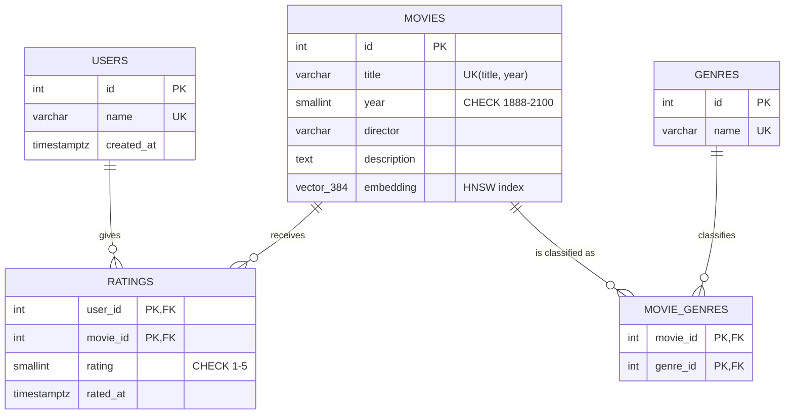

# CineSense: report material

Material for the written report and the viva: problem statement, architecture, ER diagram, normalization, the key queries, a short evaluation and likely questions.

---

## 1. Problem statement

| Industry / Domain | Problem Statement | Problem Description |
|---|---|---|
| Media & Entertainment (content recommendation) | Users struggle to discover movies relevant to their taste using only keyword or genre-based search. | Catalog search relies on exact matches (title, genre, director), so it misses movies that are similar in theme, tone or story. CineSense stores structured data (ratings, genres, metadata) in relational SQL tables and stores an embedding of each movie's description in a pgvector column. Recommendations combine a user's rating history (SQL) with nearest-neighbour search over the embeddings (vector), filtered by structured attributes like genre. This is polyglot persistence where each store does work the other can't. |

**Technology requirement:** the interface is Next.js. The database layer is SQL (PostgreSQL 16) together with a vector database (pgvector).

---

## 2. Architecture

```
Browser ──> Next.js pages (React) ──> Next.js API routes ──> PostgreSQL 16
                                          │                    ├─ relational tables (SQL)
                                          │                    └─ vector(384) column + HNSW index (pgvector)
                                          └─ all-MiniLM-L6-v2 embedding model (local, for free-text search)
```

- **Why one database for both?** pgvector is a Postgres extension, so a single SQL statement can join ratings, filter by genre **and** rank by vector distance inside one transaction. Two systems would mean syncing them and stitching results together in application code.
- **Division of work.**
  - **SQL:** identity and facts. Users, ratings (with constraints), genres (M:N), aggregates such as average rating, and filters.
  - **Vector:** meaning. Similar movies, free-text "meaning" search, and closeness to a user's taste.
  - **Hybrid:** recommendations need both. SQL says what you liked and what to exclude, and the vector search finds what's close to it.

---

## 3. ER diagram



(GitHub and VS Code render Mermaid. For the report, paste it into https://mermaid.live and export a PNG.)

**Relationships**
- USERS **M:N** MOVIES through RATINGS, an associative entity with the attribute `rating`.
- MOVIES **M:N** GENRES through MOVIE_GENRES. A movie can have several genres (Interstellar is Sci-Fi, Adventure and Drama).

**Constraints**
| Constraint | Where | Purpose |
|---|---|---|
| `PRIMARY KEY (user_id, movie_id)` | ratings | one rating per user per movie; also the conflict target for the upsert |
| `PRIMARY KEY (movie_id, genre_id)` | movie_genres | no duplicate genre tags |
| `CHECK (rating BETWEEN 1 AND 5)` | ratings | domain integrity |
| `CHECK (year BETWEEN 1888 AND 2100)` | movies | domain integrity |
| `UNIQUE (title, year)` | movies | natural key (remakes share titles but not years) |
| `UNIQUE (name)` | users, genres | no duplicates |
| `FOREIGN KEY … ON DELETE CASCADE` | ratings, movie_genres | deleting a user or movie removes its dependent rows, so no orphans |

**View.** `movie_details` joins movies, genres and ratings into one read model (genres as an array, average rating, rating count). Derived values are computed, not stored, so they can never go stale.

---

## 4. Normalization

Starting point: a single flat table, which is what a spreadsheet of ratings would look like.

`RATING_SHEET(user_name, movie_title, year, director, description, genres, rating)`, for example
`("Aarav", "Interstellar", 2014, "Christopher Nolan", "...", "Sci-Fi, Adventure, Drama", 5)`

| Step | Problem | Fix |
|---|---|---|
| **1NF** | `genres` holds a list ("Sci-Fi, Adventure, Drama"), which is not atomic. | One row per (movie, genre) pair, giving MOVIE_GENRES. |
| **2NF** | With key (user, movie), `director`, `year` and `description` depend on the movie only (a partial dependency), so they repeat for every user who rates the movie. | Move movie attributes into MOVIES(id, title, year, director, description). RATINGS keeps only (user_id, movie_id, rating). |
| **3NF** | Genre names repeat as text in every tag row, and a typo creates a new "genre". | GENRES(id, name) lookup table, and MOVIE_GENRES stores genre_id. |
| **BCNF** | Every determinant is a candidate key: `movies.id` and `(title, year)` both determine all movie attributes, and both are keys. | Already satisfied. |

**Functional dependencies (final schema)**
- users: `id → name, created_at`; `name → id`
- movies: `id → title, year, director, description, embedding`; `(title, year) → id`
- genres: `id → name`; `name → id`
- ratings: `(user_id, movie_id) → rating, rated_at`
- movie_genres: key only, with no non-key attributes

**Is the embedding column a normalization problem?** No. The embedding is a function of the description, so strictly speaking `description → embedding`. It is stored rather than computed per query because computing it is expensive (running a neural network). This is the same reasoning as any derived index key, and it is regenerated whenever the description changes (the seed hashes the text to detect this). It's worth stating this as a conscious denormalization for performance.

---

## 5. Indexes

| Index | Type | Used by |
|---|---|---|
| `ratings_pkey (user_id, movie_id)` | B-tree | a user's ratings (the leftmost prefix `user_id`) and the upsert conflict check |
| `idx_ratings_movie (movie_id)` | B-tree | joining ratings to movies, average rating per movie |
| `movie_genres_pkey (movie_id, genre_id)` | B-tree | genres of a movie |
| `idx_movie_genres_genre (genre_id)` | B-tree | movies of a genre (the genre filter) |
| `idx_movies_year (year)` | B-tree | year filters |
| `idx_movies_embedding_hnsw` | **HNSW**, `vector_cosine_ops`, m=16, ef_construction=64 | every `ORDER BY embedding <=> …` |

- **HNSW** (Hierarchical Navigable Small World) builds a layered proximity graph. A search starts at the sparse top layer and greedily walks towards the query, then descends layers. It is approximate nearest neighbour (ANN): fast, with very high but not perfect recall. `hnsw.ef_search` (default 40) trades speed for recall at query time.
- **Built after loading.** `db/indexes.sql` runs after the data is in. This matters for IVFFlat (its k-means clusters are computed from the existing rows at build time). HNSW could be built empty, but building after a bulk load is faster.
- **Why the planner often ignores the indexes here.** With 105 rows a sequential scan is cheaper than an index walk, and the planner is right to pick it. The Query Lab's *Force index* toggle (`SET LOCAL enable_seqscan = off`) shows the indexed plan, for example `Index Scan using idx_movies_embedding_hnsw … Order By: (embedding <=> $1)`.
- **Filtered ANN caveat, and the fix.** A plain HNSW scan returns `ef_search` (40) candidates and only then applies the `WHERE` filter, so a selective filter can return fewer than k rows. Testing showed this: *For You* filtered to Drama returned 10 picks although 42 unrated Drama movies existed. The fix is pgvector 0.8's iterative index scan: `lib/db.ts` runs `SET hnsw.iterative_scan = strict_order` on every new connection, so the scan keeps walking the graph until the `LIMIT` is filled, still in distance order. Other remedies: raise `hnsw.ef_search` (the Lab does `SET LOCAL hnsw.ef_search = 100`) or use partial indexes per genre.

---

## 6. Key queries

All statements live in `lib/queries.ts` and `lib/lab.ts`. Each page shows the one it ran.

### 6.1 Keyword search (pure SQL)
```sql
SELECT d.*, r.rating AS my_rating
FROM movie_details d
LEFT JOIN ratings r ON r.movie_id = d.id AND r.user_id = $3
WHERE ($1::text IS NULL OR $1 = ANY (d.genres))
  AND ($2::text IS NULL OR d.title ILIKE '%' || $2 || '%'
       OR d.director ILIKE '%' || $2 || '%' OR d.description ILIKE '%' || $2 || '%')
ORDER BY d.title;
```
Optional filters use the `($1 IS NULL OR …)` pattern so one statement serves every combination. All values are bound parameters (`$1`), which prevents SQL injection.

### 6.2 Rating upsert
```sql
INSERT INTO ratings (user_id, movie_id, rating) VALUES ($1, $2, $3)
ON CONFLICT (user_id, movie_id)
DO UPDATE SET rating = EXCLUDED.rating, rated_at = now();
```

### 6.3 More like this (vector kNN, optional SQL filter)
```sql
WITH nn AS (
  SELECT m.id, m.embedding <=> (SELECT embedding FROM movies WHERE id = $1) AS distance
  FROM movies m
  WHERE m.id <> $1
    AND (NOT $2::boolean OR EXISTS (
          SELECT 1 FROM movie_genres a JOIN movie_genres b ON b.genre_id = a.genre_id
          WHERE a.movie_id = m.id AND b.movie_id = $1))
  ORDER BY m.embedding <=> (SELECT embedding FROM movies WHERE id = $1)
  LIMIT 6
)
SELECT d.*, ROUND((1 - nn.distance)::numeric, 3) AS similarity
FROM nn JOIN movie_details d ON d.id = nn.id
ORDER BY nn.distance;
```
**Pattern:** the inner query orders the base table by distance and limits, which is the shape the HNSW index can serve. Only the 6 winners are then joined to the (aggregating) view for display. `<=>` is cosine distance, so `1 − distance` is cosine similarity.

### 6.4 Recommendations (hybrid)
1. **SQL:** fetch the user's rated movies with their embeddings.
2. **App:** taste vector = Σ (rating − 3) × embedding, normalized. 5★ = +2, 4★ = +1, 3★ = 0, 2★ = −1, 1★ = −2. This is Rocchio-style relevance feedback: liked movies pull the vector closer and disliked ones push it away.
3. **SQL + vector:**
```sql
WITH nn AS (
  SELECT m.id, m.embedding <=> $1::vector AS distance
  FROM movies m
  WHERE NOT EXISTS (SELECT 1 FROM ratings r WHERE r.user_id = $2 AND r.movie_id = m.id)
    AND ($3::text IS NULL OR EXISTS (
          SELECT 1 FROM movie_genres mg JOIN genres g ON g.id = mg.genre_id
          WHERE mg.movie_id = m.id AND g.name = $3))
  ORDER BY m.embedding <=> $1::vector
  LIMIT 12
)
SELECT d.*, ROUND((1 - nn.distance)::numeric, 3) AS similarity,
       because.id AS because_id, because.title AS because_title
FROM nn
JOIN movie_details d ON d.id = nn.id
LEFT JOIN LATERAL (
  SELECT lm.id, lm.title
  FROM ratings lr JOIN movies lm ON lm.id = lr.movie_id
  WHERE lr.user_id = $2 AND lr.rating >= 4
  ORDER BY lm.embedding <=> (SELECT embedding FROM movies WHERE id = nn.id)
  LIMIT 1
) because ON true
ORDER BY nn.distance;
```
The `LATERAL` subquery runs once per recommendation and finds the liked movie closest to it, which drives the "Because you liked X" line.

The Query Lab also shows a **pure-SQL version** that builds the taste vector inside the database with pgvector's `AVG(vector)` aggregate.

### 6.5 Cold start (SQL aggregation)
```sql
SELECT d.*, ROUND((d.avg_rating * d.rating_count + 3.5 * 3) / (d.rating_count + 3), 2) AS score
FROM movie_details d
WHERE d.rating_count > 0
  AND NOT EXISTS (SELECT 1 FROM ratings r WHERE r.user_id = $2 AND r.movie_id = d.id)
ORDER BY score DESC, d.rating_count DESC
LIMIT 12;
```
**Bayesian average:** it acts as if each movie had 3 extra ratings of 3.5 (the prior), so one 5★ rating can't beat a movie with many 4.5★ ratings.

---

## 7. Evaluation

**Keyword vs meaning search** (same 105-movie catalog):

| Query | Keyword (SQL `ILIKE`) | Meaning (pgvector) top 5 |
|---|---|---|
| "lonely robot falls in love" | 0 results | WALL-E, Her, Eternal Sunshine of the Spotless Mind, When Harry Met Sally..., The Martian |
| "astronauts lost in space" | 0 results | Gravity, The Martian, Interstellar, Alien, Moon |
| "falling in love across time" | 0 results | About Time, Past Lives, The Notebook, When Harry Met Sally..., Before Sunrise |
| "haunted house family" | 0 results | A Quiet Place, Hereditary, The Conjuring, The Babadook, Get Out |

**More like this**, nearest neighbours:
- Interstellar → Gravity, The Martian, Arrival, 2001: A Space Odyssey, Dune, Moon
- Hereditary → The Babadook, The Exorcist, The Shining, The Conjuring, A Quiet Place (and Parasite, which is close in tone)
- Spirited Away → My Neighbor Totoro, Up, Inside Out

**Previous version vs this one.** The first prototype used a hashing-trick bag-of-words vector (256 dims). It only matched shared words, so "spaceship" and "starship" were unrelated, and with a sci-fi/action user, Romance titles outranked unrated Action titles. Switching to a sentence-embedding model (all-MiniLM-L6-v2) changed only the vector column dimension and how the vectors are produced. The schema, queries and API stayed the same.

**Limitations and future work**
- Content-based only. Adding collaborative filtering (users who liked X also liked Y) would be a pure-SQL self-join on ratings that could be blended with the vector score.
- 105 movies is a demo-scale catalog. The HNSW index and query shapes are the ones that scale, and the Query Lab demonstrates the indexed plans.
- No authentication. The user switcher stands in for login.
- A Redis cache for cold-start results could be added (SQL + vector + NoSQL), but at this scale the SQL query takes about a millisecond.

---

## 8. Likely viva questions

1. **Why pgvector instead of Pinecone or Chroma?** Vectors live next to the relational data, so one query can join, filter and rank by similarity in a single transaction, with no second system to keep in sync. It is still a vector database feature set: a vector type, distance operators and ANN indexes.
2. **What is an embedding?** A fixed-length list of numbers (384 here) produced by a neural network, built so that texts with similar meaning get nearby vectors.
3. **Cosine vs Euclidean distance?** Cosine compares direction and Euclidean compares straight-line distance. MiniLM outputs unit-length vectors, and on unit vectors the two give the same ranking. The project uses cosine (`<=>`) with a matching `vector_cosine_ops` index.
4. **How does HNSW work?** It is a multi-layer graph. The search starts at the sparse top layer, greedily moves to the closest neighbour, and drops down layers until the bottom. It is approximate, and `m` and `ef_construction` (build time) and `ef_search` (query time) trade accuracy for speed.
5. **HNSW vs IVFFlat?** IVFFlat clusters vectors with k-means and searches the nearest `probes` clusters. It is faster to build, but must be built after loading data and has lower recall. HNSW has better recall and speed, a slower build and more memory.
6. **Why doesn't EXPLAIN show the index?** At 105 rows a sequential scan is cheaper, and the planner is right. Forcing it (`enable_seqscan = off`) shows the index plan.
7. **What normal form is the schema in, and why?** BCNF. Every determinant is a candidate key. See section 4, including the decision to store the embedding.
8. **How do you stop duplicate ratings?** The composite primary key (user_id, movie_id) and `INSERT … ON CONFLICT DO UPDATE`.
9. **What is the cold-start problem?** A new user has no history, so the system falls back to a Bayesian-average popularity ranking, computed with `GROUP BY` in SQL.
10. **How do disliked movies affect recommendations?** The taste vector weights each rated movie by (rating − 3), so 1-2★ movies subtract from it and the nearest neighbours move away from them.
11. **What does the LATERAL join do?** It runs a correlated subquery per result row. Here it finds, for each recommendation, the liked movie it is closest to ("Because you liked X").
12. **What happens when a user is deleted?** `ON DELETE CASCADE` removes their ratings automatically.
13. **Where does the embedding model run?** Locally, inside the Next.js server process (ONNX Runtime), with no external API. Movie embeddings are precomputed at seed time. Only free-text search embeds at request time.
14. **How would you scale to a million movies?** The HNSW index is already in place. Tune `ef_search`, add partial indexes for hot filters, cache cold-start results, and batch-embed new movies in a background job.
