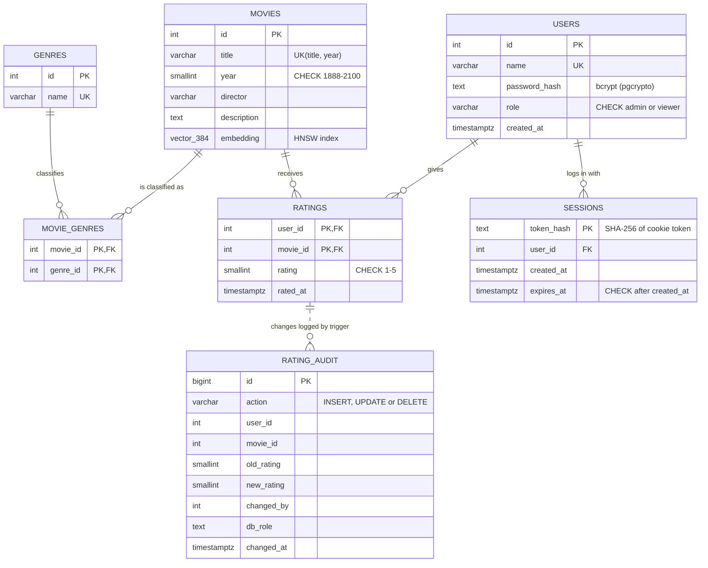
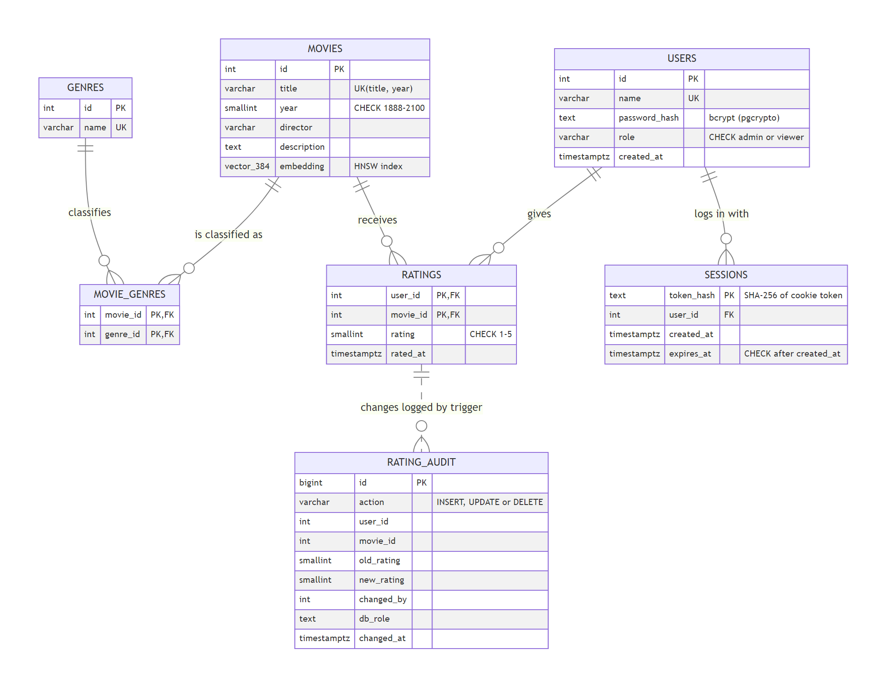

# CineSense: report material

Material for the written report and the viva: problem statement, technology justification, architecture, ER diagram, normalization, indexes, stored functions, procedures and triggers, authentication and role-based access control, vector CRUD, the key queries, an evaluation and likely questions. [RUBRIC.md](RUBRIC.md) maps every rubric line to where it is implemented.

---

## 1. Problem statement

| Industry / Domain | Problem Statement | Problem Description |
|---|---|---|
| Media & Entertainment (content recommendation) | Users struggle to discover movies relevant to their taste using only keyword or genre-based search. | Catalog search relies on exact matches (title, genre, director), so it misses movies that are similar in theme, tone or story. CineSense stores structured data (ratings, genres, metadata) in relational SQL tables and stores an embedding of each movie's description in a pgvector column. Recommendations combine a user's rating history (SQL) with nearest-neighbour search over the embeddings (vector), filtered by structured attributes like genre. This is polyglot persistence where each store does work the other can't. |

**Technology requirement:** the interface is Next.js. The database layer is SQL (PostgreSQL 16) together with a vector database (pgvector).

---

## 1a. Technology justification

| Choice | Why it fits this problem | Alternatives considered |
|---|---|---|
| **PostgreSQL 16** (SQL) | Users, ratings and genres are structured, related facts that need keys, constraints, joins, aggregates and transactions. Postgres also provides what the advanced parts need: PL/pgSQL functions and procedures, triggers, recursive CTEs, database roles with GRANTs, and row-level security. | MySQL has no row-level security or vector type built in. |
| **pgvector** (vector database) | Movie meaning is captured as a 384-dimension embedding. pgvector adds a `vector` type, distance operators (`<=>` cosine) and an HNSW approximate-nearest-neighbour index **inside** the same database, so one SQL statement can join ratings, filter by genre and rank by similarity in one transaction. | Pinecone or Chroma would be a second system to keep in sync with the SQL data, and every hybrid query would be stitched together in application code. |
| **all-MiniLM-L6-v2** embeddings | A small (90 MB), fast sentence-embedding model that runs locally in Node.js with no API key or cost. 384 dimensions is enough to separate themes like "space survival" and "family horror". | OpenAI embeddings need a paid key and send data to a third party. |
| **Next.js 16** (App Router) | Required by the brief. One codebase holds the React pages and the server-side API routes. The browser never connects to the database, and route handlers run every query as the signed-in user's database role. | A separate Express backend would add a second project for no benefit. |
| **pgcrypto** | bcrypt password hashing and secure random session tokens, computed inside the database, so login logic lives next to the data it protects. | Hashing in Node.js would put the password check outside the database's control. |

---

## 2. Architecture

```
Browser ──> Next.js pages (React) ──> Next.js API routes ──────────> PostgreSQL 16
   │ httpOnly session cookie               │  login: cinesense_app        ├─ relational tables (SQL)
   └───────────────────────────────────────┤  SET LOCAL ROLE per request: ├─ vector(384) column + HNSW index (pgvector)
                                           │  anon / viewer / admin       ├─ functions, procedures, triggers
                                           │                              └─ roles, GRANTs, row-level security
                                           └─ all-MiniLM-L6-v2 embedding model (local; meaning search and new movies)
```

- **Why one database for both?** pgvector is a Postgres extension, so a single SQL statement can join ratings, filter by genre **and** rank by vector distance inside one transaction. Two systems would mean syncing them and stitching results together in application code.
- **Division of work.**
  - **SQL:** identity and facts. Users, ratings (with constraints), genres (M:N), aggregates such as average rating, and filters.
  - **Vector:** meaning. Similar movies, free-text "meaning" search, and closeness to a user's taste.
  - **Hybrid:** recommendations need both. SQL says what you liked and what to exclude, and the vector search finds what's close to it.
- **Security boundary.** The app logs in as `cinesense_app`, a role with no privileges of its own. Each request runs in one transaction that switches to `cinesense_anon`, `cinesense_viewer` or `cinesense_admin` according to the session, so PostgreSQL itself decides what each user may read or change (section 8).

---

## 3. ER diagram





(The PNG above is rendered from the Mermaid source. GitHub and VS Code also render the Mermaid block directly.)

**Relationships**
- USERS **M:N** MOVIES through RATINGS, an associative entity with the attribute `rating`.
- MOVIES **M:N** GENRES through MOVIE_GENRES. A movie can have several genres (Interstellar is Sci-Fi, Adventure and Drama).
- USERS **1:N** SESSIONS. A user can be logged in on several devices; deleting the user ends them all.
- RATING_AUDIT has **no foreign keys on purpose**: it is a history log, so it must keep rows for users and movies that were later deleted. It is written only by a trigger (dotted line).

**Constraints**
| Constraint | Where | Purpose |
|---|---|---|
| `PRIMARY KEY (user_id, movie_id)` | ratings | one rating per user per movie; also the conflict target for the upsert |
| `PRIMARY KEY (movie_id, genre_id)` | movie_genres | no duplicate genre tags |
| `CHECK (rating BETWEEN 1 AND 5)` | ratings | domain integrity |
| `CHECK (year BETWEEN 1888 AND 2100)` | movies | domain integrity |
| `UNIQUE (title, year)` | movies | natural key (remakes share titles but not years) |
| `UNIQUE (name)` | users, genres | no duplicates |
| `FOREIGN KEY … ON DELETE CASCADE` | ratings, movie_genres, sessions | deleting a user or movie removes its dependent rows, so no orphans |
| `CHECK (role IN ('admin', 'viewer'))` | users | only the two defined roles can exist |
| `CHECK (expires_at > created_at)` | sessions | a session can't expire before it starts |
| `CHECK (action IN ('INSERT','UPDATE','DELETE'))` | rating_audit | domain integrity for the log |

**View.** `movie_details` joins movies, genres and ratings into one read model (genres as an array, average rating, rating count). Derived values are computed, not stored, so they can never go stale.

---

## 4. Normalization

Starting point: a single flat table, which is what a spreadsheet of ratings would look like.

`RATING_SHEET(user_name, movie_title, year, director, description, genres, rating)`, for example
`("Aarav", "Interstellar", 2014, "Christopher Nolan", "...", "Sci-Fi, Adventure, Drama", 5)`

| Step | Problem | Fix |
|---|---|---|
| **1NF** | `genres` holds a list ("Sci-Fi, Adventure, Drama"), which is not atomic. | One row per (movie, genre) pair, giving MOVIE_GENRES. |
| **2NF** | With key (user, movie), `director`, `year` and `description` depend on the movie only (a partial dependency), so they repeat for every user who rates the movie. | Move movie attributes into MOVIES(id, title, year, director, description). RATINGS keeps only (user_id, movie_id, rating). |
| **3NF** | Genre names repeat as text in every tag row, and a typo creates a new "genre". | GENRES(id, name) lookup table, and MOVIE_GENRES stores genre_id. |
| **BCNF** | Every determinant is a candidate key: `movies.id` and `(title, year)` both determine all movie attributes, and both are keys. | Already satisfied. |

**Functional dependencies (final schema)**
- users: `id → name, password_hash, role, created_at`; `name → id`
- movies: `id → title, year, director, description, embedding`; `(title, year) → id`
- genres: `id → name`; `name → id`
- ratings: `(user_id, movie_id) → rating, rated_at`
- movie_genres: key only, with no non-key attributes
- sessions: `token_hash → user_id, created_at, expires_at`
- rating_audit: `id → action, user_id, movie_id, old_rating, new_rating, changed_by, db_role, changed_at`

Every determinant in every table is a candidate key (users and movies each have two keys that determine each other), so all of them are in BCNF. `role` is a CHECK-constrained column rather than a lookup table because the set of roles is fixed by the database's own roles (section 8), not data that users edit.

**Is the embedding column a normalization problem?** No. The embedding is a function of the description, so strictly speaking `description → embedding`. It is stored rather than computed per query because computing it is expensive (running a neural network). This is the same reasoning as any derived index key, and it is regenerated whenever the description changes (the seed hashes the text to detect this). It's worth stating this as a conscious denormalization for performance.

---

## 5. Indexes

| Index | Type | Used by |
|---|---|---|
| `ratings_pkey (user_id, movie_id)` | B-tree | a user's ratings (the leftmost prefix `user_id`) and the upsert conflict check |
| `idx_ratings_movie (movie_id)` | B-tree | joining ratings to movies, average rating per movie |
| `movie_genres_pkey (movie_id, genre_id)` | B-tree | genres of a movie |
| `idx_movie_genres_genre (genre_id)` | B-tree | movies of a genre (the genre filter) |
| `idx_movies_year (year)` | B-tree | year filters |
| `idx_movies_embedding_hnsw` | **HNSW**, `vector_cosine_ops`, m=16, ef_construction=64 | every `ORDER BY embedding <=> …` |
| `sessions_pkey (token_hash)` | B-tree | the session lookup on every request (`current_app_user()`) |
| `idx_sessions_user (user_id)` | B-tree | the cascade when a user is deleted, and the admin's active-session count |
| `idx_rating_audit_time (changed_at DESC)` | B-tree | the newest-first activity log |

- **HNSW** (Hierarchical Navigable Small World) builds a layered proximity graph. A search starts at the sparse top layer and greedily walks towards the query, then descends layers. It is approximate nearest neighbour (ANN): fast, with very high but not perfect recall. `hnsw.ef_search` (default 40) trades speed for recall at query time.
- **Built after loading.** `db/indexes.sql` runs after the data is in. This matters for IVFFlat (its k-means clusters are computed from the existing rows at build time). HNSW could be built empty, but building after a bulk load is faster.
- **Why the planner often ignores the indexes here.** With 105 rows a sequential scan is cheaper than an index walk, and the planner is right to pick it. The Query Lab's *Force index* toggle (`SET LOCAL enable_seqscan = off`) shows the indexed plan, for example `Index Scan using idx_movies_embedding_hnsw … Order By: (embedding <=> $1)`.
- **Filtered ANN caveat, and the fix.** A plain HNSW scan returns `ef_search` (40) candidates and only then applies the `WHERE` filter, so a selective filter can return fewer than k rows. Testing showed this: *For You* filtered to Drama returned 10 picks although 42 unrated Drama movies existed. The fix is pgvector 0.8's iterative index scan: `lib/db.ts` runs `SET hnsw.iterative_scan = strict_order` on every new connection, so the scan keeps walking the graph until the `LIMIT` is filled, still in distance order. Other remedies: raise `hnsw.ef_search` (the Lab does `SET LOCAL hnsw.ef_search = 100`) or use partial indexes per genre.

---

## 6. Key queries

All statements live in `lib/queries.ts` and `lib/lab.ts`. Each page shows the one it ran.

### 6.1 Keyword search (pure SQL)
```sql
SELECT d.*, r.rating AS my_rating
FROM movie_details d
LEFT JOIN ratings r ON r.movie_id = d.id AND r.user_id = $3
WHERE ($1::text IS NULL OR $1 = ANY (d.genres))
  AND ($2::text IS NULL OR d.title ILIKE '%' || $2 || '%'
       OR d.director ILIKE '%' || $2 || '%' OR d.description ILIKE '%' || $2 || '%')
ORDER BY d.title;
```
Optional filters use the `($1 IS NULL OR …)` pattern so one statement serves every combination. All values are bound parameters (`$1`), which prevents SQL injection.

### 6.2 Rating upsert
```sql
INSERT INTO ratings (user_id, movie_id, rating) VALUES ($1, $2, $3)
ON CONFLICT (user_id, movie_id)
DO UPDATE SET rating = EXCLUDED.rating;
```
`rated_at` is moved by the `trg_ratings_touch` trigger, and the `trg_ratings_audit` trigger records the change. The `user_id` is always the signed-in user from the session, never a value sent by the browser, and row-level security would refuse any other.

### 6.3 More like this (vector kNN, optional SQL filter)
```sql
WITH nn AS (
  SELECT m.id, m.embedding <=> (SELECT embedding FROM movies WHERE id = $1) AS distance
  FROM movies m
  WHERE m.id <> $1 AND m.embedding IS NOT NULL
    AND (SELECT embedding FROM movies WHERE id = $1) IS NOT NULL   -- no vector yet: no neighbours
    AND (NOT $2::boolean OR EXISTS (
          SELECT 1 FROM movie_genres a JOIN movie_genres b ON b.genre_id = a.genre_id
          WHERE a.movie_id = m.id AND b.movie_id = $1))
  ORDER BY m.embedding <=> (SELECT embedding FROM movies WHERE id = $1)
  LIMIT 6
)
SELECT d.*, ROUND((1 - nn.distance)::numeric, 3) AS similarity
FROM nn JOIN movie_details d ON d.id = nn.id
ORDER BY nn.distance;
```
**Pattern:** the inner query orders the base table by distance and limits, which is the shape the HNSW index can serve. Only the 6 winners are then joined to the (aggregating) view for display. `<=>` is cosine distance, so `1 − distance` is cosine similarity.

### 6.4 Recommendations (hybrid)
1. **SQL:** fetch the user's rated movies with their embeddings.
2. **App:** taste vector = Σ (rating − 3) × embedding, normalized. 5★ = +2, 4★ = +1, 3★ = 0, 2★ = −1, 1★ = −2. This is Rocchio-style relevance feedback: liked movies pull the vector closer and disliked ones push it away.
3. **SQL + vector:**
```sql
WITH nn AS (
  SELECT m.id, m.embedding <=> $1::vector AS distance
  FROM movies m
  WHERE m.embedding IS NOT NULL
    AND NOT EXISTS (SELECT 1 FROM ratings r WHERE r.user_id = $2 AND r.movie_id = m.id)
    AND ($3::text IS NULL OR EXISTS (
          SELECT 1 FROM movie_genres mg JOIN genres g ON g.id = mg.genre_id
          WHERE mg.movie_id = m.id AND g.name = $3))
  ORDER BY m.embedding <=> $1::vector
  LIMIT 12
)
SELECT d.*, ROUND((1 - nn.distance)::numeric, 3) AS similarity,
       because.id AS because_id, because.title AS because_title
FROM nn
JOIN movie_details d ON d.id = nn.id
LEFT JOIN LATERAL (
  SELECT lm.id, lm.title
  FROM ratings lr JOIN movies lm ON lm.id = lr.movie_id
  WHERE lr.user_id = $2 AND lr.rating >= 4
  ORDER BY lm.embedding <=> (SELECT embedding FROM movies WHERE id = nn.id)
  LIMIT 1
) because ON true
ORDER BY nn.distance;
```
The `LATERAL` subquery runs once per recommendation and finds the liked movie closest to it, which drives the "Because you liked X" line.

The Query Lab also shows a **pure-SQL version** that builds the taste vector inside the database with pgvector's `AVG(vector)` aggregate.

### 6.5 Cold start (SQL aggregation)
```sql
SELECT d.*, bayesian_score(d.avg_rating, d.rating_count) AS score   -- stored function, section 7
FROM movie_details d
WHERE d.rating_count > 0
  AND NOT EXISTS (SELECT 1 FROM ratings r WHERE r.user_id = $2 AND r.movie_id = d.id)
ORDER BY score DESC, d.rating_count DESC, d.title
LIMIT 12;
```
**Bayesian average:** it acts as if each movie had 3 extra ratings of 3.5 (the prior), so one 5★ rating can't beat a movie with many 4.5★ ratings.

---

## 7. Stored functions, procedures and triggers

All live in [`db/functions.sql`](../db/functions.sql) and run inside PostgreSQL.

| Object | Kind | What it does | Used by |
|---|---|---|---|
| `bayesian_score(avg, n)` | SQL function (IMMUTABLE) | Bayesian average: as if every movie had 3 extra ratings of 3.5 | cold-start list, Query Lab |
| `register_user(name, password)` | PL/pgSQL function, SECURITY DEFINER | validates the password length and stores a bcrypt hash | Sign up |
| `login(name, password)` | PL/pgSQL function, SECURITY DEFINER | checks the hash with `crypt()`, creates a 7-day session, returns its token once | Log in |
| `current_app_user()` / `whoami()` | SQL functions, SECURITY DEFINER | turn the session token into the user (and role) for this transaction | every request, every RLS policy |
| `logout()` | SQL function | deletes the current session | Log out |
| `similarity_trail(movie, steps)` | SQL function wrapping a **recursive CTE** | walks from a movie to its nearest unvisited neighbour, step by step | movie page, Query Lab |
| `add_movie(...)` | **procedure** with an INOUT id | inserts a movie with its vector and links its genres, creating new genres | Admin → Add movie |
| `update_movie(...)` | procedure | edits a movie, its genres and (optionally) its vector | Admin → Edit |
| `set_movie_genres(movie, genres[])` | procedure | replaces a movie's genre links (called by the two above) | |
| `set_user_role(user, role)` | procedure | promotes or demotes a user, refusing to remove the last admin | Admin → Users |

**Triggers**

| Trigger | When | Why |
|---|---|---|
| `trg_ratings_audit` | AFTER INSERT, UPDATE OF rating, DELETE on ratings, per row | writes every rating change to `rating_audit` with the old and new value, the signed-in user and the database role. The function is SECURITY DEFINER, so viewers can write the log only through the trigger. Re-saving the same value is ignored. Ratings removed by a cascading delete are logged too. |
| `trg_ratings_touch` | BEFORE UPDATE OF rating, only `WHEN (OLD.rating IS DISTINCT FROM NEW.rating)` | sets `rated_at = now()`, so the timestamp moves only on a real change and the upsert doesn't need to set it |
| `trg_movies_stale_embedding` | BEFORE UPDATE OF title, description on movies | if the text changed but no new vector was supplied, clears the old vector, so similarity search never uses a description that no longer exists. This keeps the SQL data and the vector data consistent. |

**Query types used** (all visible in the Query Lab with their EXPLAIN ANALYZE plans)

| Type | Example | Where |
|---|---|---|
| Inner and outer joins | movies ⋈ movie_genres ⋈ genres; `LEFT JOIN ratings` for "my rating" | `lib/queries.ts` keywordSearch, Lab "Genre filter" |
| Nested (non-correlated) subquery | users `NOT IN (SELECT user_id … WHERE genre = 'Horror')` | Lab "Users who never rated a genre" |
| Correlated subquery | `NOT EXISTS (SELECT 1 FROM ratings r WHERE r.movie_id = m.id …)`; each genre's average compared per row; the `LATERAL` "because you liked" lookup | recommend, popular, Lab "Above their genre's average" |
| Recursive CTE | `WITH RECURSIVE trail …` | `similarity_trail()`, Lab "Similarity trail" |
| CTE | `WITH nn AS (… ORDER BY embedding <=> … LIMIT k)` | every vector query |
| Aggregation | `GROUP BY`, `AVG`, `COUNT`, `HAVING`, `array_agg`, pgvector `AVG(vector)` | movie_details view, Lab "Top rated", Lab "Recommendations, entirely in SQL" |

---

## 8. Authentication and role-based access control

**Authentication.** Passwords are hashed with bcrypt (`crypt(password, gen_salt('bf'))` from pgcrypto) inside `register_user()`. `login()` compares hashes in the database and creates a session with a random 256-bit token. Only the token's SHA-256 hash is stored, and the token goes to the browser in an **httpOnly, SameSite=Lax** cookie that page scripts cannot read. Logging out deletes the session row; deleting a user cascades to their sessions.

**Roles.** Two application roles, `viewer` and `admin`, map to database roles in a hierarchy ([`db/security.sql`](../db/security.sql)):

| Database role | Who | Privileges |
|---|---|---|
| `cinesense_anon` | visitors | SELECT on the catalog (movies, genres, movie_genres, movie_details, ratings); EXECUTE on register, login and whoami |
| `cinesense_viewer` (inherits anon) | logged-in users | INSERT and DELETE on ratings and UPDATE of the `rating` column only (a column-level grant), all limited to **their own rows** by row-level security |
| `cinesense_admin` (inherits viewer) | administrators | INSERT, UPDATE and DELETE on movies, genres and movie_genres; UPDATE of `users.role`; DELETE on users; SELECT on rating_audit; EXECUTE on the catalog procedures. SELECT on users and sessions is column-level and excludes `password_hash` and `token_hash`. |
| `cinesense_app` | the Next.js server's login | **NOINHERIT** and no privileges of its own; it may only `SET ROLE` to the three roles above |

**How a request runs** (`withSession()` in [`lib/db.ts`](../lib/db.ts)):
1. `BEGIN`, then `SET LOCAL ROLE cinesense_anon` and `set_config('app.session_token', <cookie>, true)`.
2. `whoami()` validates the token in the database and returns the user and role.
3. `SET LOCAL ROLE cinesense_viewer` or `cinesense_admin`, then the route's queries run, then `COMMIT`.

**Row-level security** on `ratings`: everyone may read (averages are public), but the viewer policies require `user_id = current_app_user()` for INSERT, UPDATE and DELETE, and an admin policy allows every row. Because `current_app_user()` checks the session token against the `sessions` table, even a bug in the app that passed the wrong user id would be refused by the database (error 42501, returned as HTTP 403).

**Enforced three times:** the pages hide links and show "Admins only" (front end), each API route declares the role it needs (401 or 403), and PostgreSQL's GRANTs and policies refuse anything else.

---

## 9. Vector database: create, read, update, delete

| Operation | Where | SQL |
|---|---|---|
| **Create** | Admin → Add movie | the description is embedded (MiniLM, 384 dims), then `CALL add_movie(…, $6::vector, NULL)` |
| **Read** | Browse "Meaning", More like this, For You, the Admin table | `ORDER BY embedding <=> $1 LIMIT k` (HNSW); the admin table shows `vector_dims()` and `vector_norm()` of every vector |
| **Update** | Admin → Edit (re-embeds the new text), Admin → Re-embed | `CALL update_movie(…, $7::vector)` or `UPDATE movies SET embedding = $2::vector`; the stale-embedding trigger clears a vector whose text changed without a new one |
| **Delete** | Admin → Delete | `DELETE FROM movies WHERE id = $1` removes the vector and its HNSW index entry; ratings and genre links go with it through `ON DELETE CASCADE` |

Testing showed each step working: a new movie about a robot was the top meaning-search hit for "robot friendship by the ocean". After its description was edited to a bank heist and re-embedded, it dropped out of that search and became the top hit for "crime boss bank heist", and its "More like this" changed from WALL-E to crime films.

---

## 10. Evaluation

**Keyword vs meaning search** (same 105-movie catalog):

| Query | Keyword (SQL `ILIKE`) | Meaning (pgvector) top 5 |
|---|---|---|
| "lonely robot falls in love" | 0 results | WALL-E, Her, Eternal Sunshine of the Spotless Mind, When Harry Met Sally..., The Martian |
| "astronauts lost in space" | 0 results | Gravity, The Martian, Interstellar, Alien, Moon |
| "falling in love across time" | 0 results | About Time, Past Lives, The Notebook, When Harry Met Sally..., Before Sunrise |
| "haunted house family" | 0 results | A Quiet Place, Hereditary, The Conjuring, The Babadook, Get Out |

**More like this**, nearest neighbours:
- Interstellar → Gravity, The Martian, Arrival, 2001: A Space Odyssey, Dune, Moon
- Hereditary → Parasite (no shared genre, but both describe a family unravelling, which is what the embedding picks up), then The Babadook, The Exorcist, The Shining, The Conjuring, A Quiet Place
- Spirited Away → My Neighbor Totoro, Up, Inside Out

**Previous version vs this one.** The first prototype used a hashing-trick bag-of-words vector (256 dims). It only matched shared words, so "spaceship" and "starship" were unrelated, and with a sci-fi/action user, Romance titles outranked unrated Action titles. Switching to a sentence-embedding model (all-MiniLM-L6-v2) changed only the vector column dimension and how the vectors are produced. The schema, queries and API stayed the same.

**Limitations and future work**
- Content-based only. Adding collaborative filtering (users who liked X also liked Y) would be a pure-SQL self-join on ratings that could be blended with the vector score.
- 105 movies is a demo-scale catalog. The HNSW index and query shapes are the ones that scale, and the Query Lab demonstrates the indexed plans.
- Sessions last 7 days and are not refreshed on activity; a production system would add rate limiting on login and password reset.
- A Redis cache for cold-start results could be added (SQL + vector + NoSQL), but at this scale the SQL query takes about a millisecond.

---

## 11. Likely viva questions

1. **Why pgvector instead of Pinecone or Chroma?** Vectors live next to the relational data, so one query can join, filter and rank by similarity in a single transaction, with no second system to keep in sync. It is still a vector database feature set: a vector type, distance operators and ANN indexes.
2. **What is an embedding?** A fixed-length list of numbers (384 here) produced by a neural network, built so that texts with similar meaning get nearby vectors.
3. **Cosine vs Euclidean distance?** Cosine compares direction and Euclidean compares straight-line distance. MiniLM outputs unit-length vectors, and on unit vectors the two give the same ranking. The project uses cosine (`<=>`) with a matching `vector_cosine_ops` index.
4. **How does HNSW work?** It is a multi-layer graph. The search starts at the sparse top layer, greedily moves to the closest neighbour, and drops down layers until the bottom. It is approximate, and `m` and `ef_construction` (build time) and `ef_search` (query time) trade accuracy for speed.
5. **HNSW vs IVFFlat?** IVFFlat clusters vectors with k-means and searches the nearest `probes` clusters. It is faster to build, but must be built after loading data and has lower recall. HNSW has better recall and speed, a slower build and more memory.
6. **Why doesn't EXPLAIN show the index?** At 105 rows a sequential scan is cheaper, and the planner is right. Forcing it (`enable_seqscan = off`) shows the index plan.
7. **What normal form is the schema in, and why?** BCNF. Every determinant is a candidate key. See section 4, including the decision to store the embedding.
8. **How do you stop duplicate ratings?** The composite primary key (user_id, movie_id) and `INSERT … ON CONFLICT DO UPDATE`.
9. **What is the cold-start problem?** A new user has no history, so the system falls back to a Bayesian-average popularity ranking, computed with `GROUP BY` in SQL.
10. **How do disliked movies affect recommendations?** The taste vector weights each rated movie by (rating − 3), so 1-2★ movies subtract from it and the nearest neighbours move away from them.
11. **What does the LATERAL join do?** It runs a correlated subquery per result row. Here it finds, for each recommendation, the liked movie it is closest to ("Because you liked X").
12. **What happens when a user is deleted?** `ON DELETE CASCADE` removes their ratings and sessions automatically, and the audit trigger records each removed rating, so the history survives in `rating_audit`.
13. **Where does the embedding model run?** Locally, inside the Next.js server process (ONNX Runtime), with no external API. Movie embeddings are precomputed at seed time. Only free-text search embeds at request time.
14. **How would you scale to a million movies?** The HNSW index is already in place. Tune `ef_search`, add partial indexes for hot filters, cache cold-start results, and batch-embed new movies in a background job.
15. **How is role-based access control enforced in the database, not just the app?** The app's login role `cinesense_app` is NOINHERIT with no privileges. Every request runs `SET LOCAL ROLE` to `cinesense_anon`, `cinesense_viewer` or `cinesense_admin`, so PostgreSQL's GRANTs decide what each query may touch. A viewer trying to delete a movie gets `permission denied` (42501) from the database itself.
16. **What is row-level security and how do you use it?** Policies on a table filter which rows a role can see or change. On `ratings`, viewers may only insert, update or delete rows where `user_id = current_app_user()`, a function that validates the session token in the database. Admins have a policy that allows all rows.
17. **Why SECURITY DEFINER on some functions?** They run with the owner's rights, so restricted roles can use them without direct table access: `login()` can read `password_hash` that no role may SELECT, and the audit trigger can write `rating_audit` that viewers can't INSERT into. Each sets `search_path` to stop a caller from shadowing objects.
18. **How are passwords stored?** As bcrypt hashes from pgcrypto's `crypt(p, gen_salt('bf'))`, with a per-password salt. Login recomputes `crypt(input, stored_hash)` and compares. Session tokens are random 256-bit values; only their SHA-256 hash is stored, so a copied sessions table can't be used to log in.
19. **Function vs procedure?** A function returns a value and can be used inside a query (`SELECT bayesian_score(…)`); a procedure is invoked with `CALL`, returns results only through INOUT parameters, and may manage transactions. `add_movie` is a procedure because it performs several writes as one operation.
20. **Explain the recursive CTE.** The anchor member selects the starting movie. The recursive member joins the previous step to its nearest movie not yet in the `path` array (a LATERAL subquery with `ORDER BY embedding <=> … LIMIT 1`). It stops after `p_steps` iterations or when no new movie is found.
21. **What do your triggers do?** `trg_ratings_audit` logs every rating insert, change and delete with the old and new value, the user and the database role. `trg_ratings_touch` updates `rated_at` only when the value changes. `trg_movies_stale_embedding` clears a movie's vector when its text changes without a new one, keeping the vector data consistent with the SQL data.
22. **Correlated vs nested subquery?** A nested subquery runs once, independent of the outer query (`NOT IN (SELECT user_id … )`). A correlated one refers to the outer row and is logically re-run per row (`NOT EXISTS (SELECT 1 FROM ratings r WHERE r.movie_id = m.id)`).
